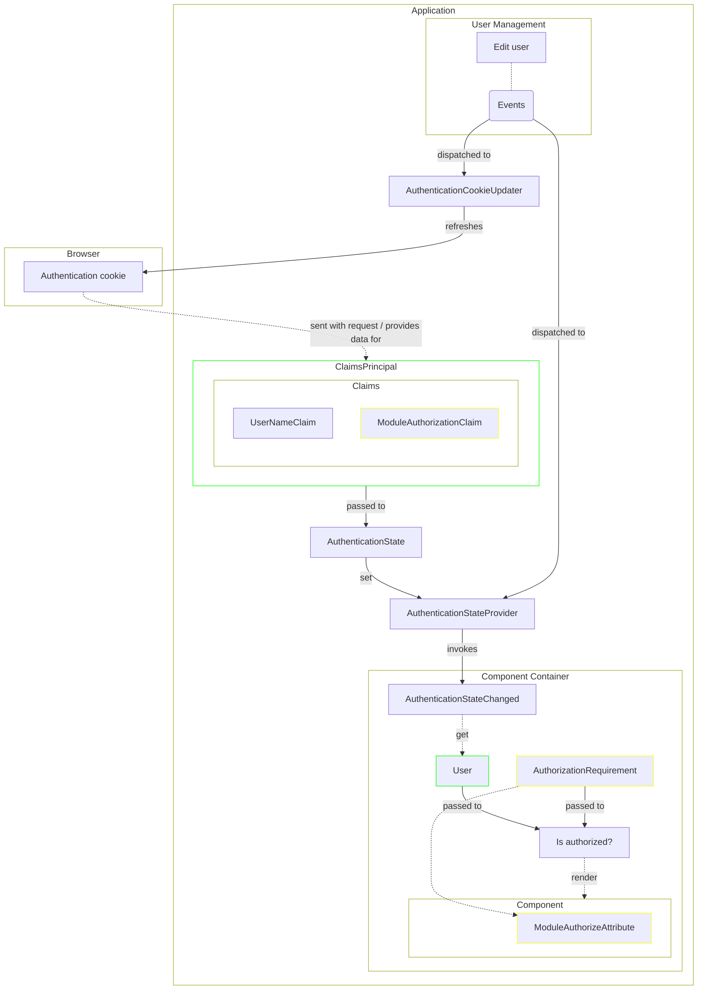

[[_TOC_]]

# Introduction

This document describes security and identity topics.

## Account Lockout

ASP.NET Identity's lockout feature is enabled to slow down online password guessing.

- **Threshold:** 5 failed attempts within the lockout window lock the account.
- **Duration:** 5 minutes; lockout end is auto-extended on each new failure during the window.
- **Auto-unlock only:** there is no admin unlock UI; locked accounts unlock automatically once the window elapses, or implicitly when the user completes a password reset via emailed token.
- **No enumeration:** a locked account surfaces the same generic "user or password is incorrect" message as a wrong password. Callers cannot distinguish locked from invalid.
- **Scope of counter increments:**
  - Password sign-in increments on failure (`SignInManager.PasswordSignInAsync` with `lockoutOnFailure: true`).
  - The "change password" flow checks lockout up front and increments on a wrong current password.
  - Passkey sign-in and external (OIDC) sign-in **respect** an existing lockout but do not increment the counter — those auth paths are not credential-guessing surfaces.
- **Out of scope:**
  - Guessing across many accounts, which a per-account counter cannot see; the per-client sign-in limit under [Rate Limiting](#rate-limiting) slows it down.
  - No protection inside the `UpdateUser` profile-change command path — that consumer calls `ChangePasswordAsync` directly without consulting the lockout state.
  - The bootstrapped system administrator is subject to lockout like any other account.

## Authorization

Propagating changes to a user to frontend components:

## Security Headers

The Content Security Policy itself is decided in [ADR-006](ADRs/ADR-006-content-security-policy.md); this section only records which layer sends which header, and why.

- **The Suite sends the policy, `X-Frame-Options` and `Permissions-Policy`**, from `ContentSecurityPolicy` and `UseSecurityHeaders`.
  It is the only layer present in every deployment — installations also run Kestrel directly or sit behind a customer-managed proxy — which is what decided it in the ADR.
- **`Permissions-Policy` disables camera, microphone, geolocation, screen capture, payment, USB, serial, HID and Bluetooth.**
  Nothing in the Suite uses them, so script injected into its origin cannot reach them either, not even where the user once granted the origin access.
  Passkeys (`publickey-credentials-get` and `-create`) and `clipboard-write` stay unlisted: the Suite uses both, and their default allowlist `self` already keeps them from foreign frames.
  Only Chromium-based browsers enforce the header; Firefox and Safari ignore it.
  A module that needs a disabled feature stops working in Chromium, and enabling the feature again takes a release.
- **The failsafe and downgrade hosts send a stricter policy of their own**, because they answer when the Suite did not come up.
  They carry no reporting directive — the app that would answer `/csp-report` is the one that failed.
- **The packaged nginx sends HSTS, `X-Content-Type-Options` and `Referrer-Policy`**, and deliberately no CSP, no `X-Frame-Options` and no `Permissions-Policy`.
  A duplicate `X-Frame-Options` may be ignored by the browser altogether, so exactly one sender is the point.
- **`src/html/unavailable.html` in `deb-packaging` needs no CSP exception**, although it carries an inline `<style>` and `<script>`.
  nginx serves it only when the upstream is unreachable, so no policy of the Suite's can be on that response, and nginx sends none of its own.
- **Editing the nginx fragments carries one trap:** an `add_header` inside a `location` discards every server-level `add_header` for that location, so a location added later silently loses HSTS, `nosniff` and `Referrer-Policy` unless each is repeated there.
  `src/nginx/header` carries the same note.

### Deployment

- **TLS is required for violation reporting.** `report-to` registers an endpoint only on a cryptographic origin, and a browser that supports it ignores `report-uri`, so an installation served over plain `http://` reports no violations at all.
  TLS terminated at a proxy is enough, since what counts is the scheme the browser sees.
- **The policy does not vary by environment.** There is no Development variant, so what E2E exercises is the header a customer gets.
  It does vary per instance in one directive: `form-action` names the origin of the configured OpenID provider, without which the browser refuses the challenge redirect.
  The origin is read from the OpenID options themselves, so it follows a provider change without a restart.

## Rate Limiting

The suite answers requests above a client's rate with `429 Too Many Requests` and a `Retry-After` header, so excess traffic is refused before it saturates the device ([suite#2973](https://gitlab.com/vicione-oss/vicione/suite/suite/-/work_items/2973), found in [issue-defect-management#544](https://gitlab.com/vicione-oss/issue-defect-management/-/work_items/544)).

| Limit | Default | Setting |
|-------|---------|---------|
| Requests per client | 10 per second, bursts up to 50 | `RateLimiting:PermitsPerSecond`, `RateLimiting:Burst` |
| Sign-in and account form posts per client | 20 per minute | `RateLimiting:SignInPermitsPerMinute` |
| Requests of all clients in progress at once | 45 | `RateLimiting:MaxConcurrentRequests` |

`RateLimiting:Enabled=false` turns all three off; a value out of range stops the instance at startup.

- **The suite limits, nginx does not**, for the reason [ADR-006](ADRs/ADR-006-content-security-policy.md) gives for the policy: the app is the only layer present in every deployment.
  Kestrel's connection limits are not used either, because they close the connection instead of answering `429`.
- **A client is an address**, as `UseForwardedHeaders` resolves it, so behind the packaged nginx or a proxy listed in `Instance:TrustedProxies` every client is counted on its own.
  IPv6 clients are counted per address too, not per `/64`, because on a device's LAN every client shares one `/64`.
- **Clients sharing an address share the limits**: everyone behind one NAT router, and everyone behind a customer proxy in front of the packaged nginx — the suite reads only the last forwarded hop, which is that proxy.
- **The sign-in limit** counts the form posts of the anonymous account pages (sign-in, expired-password change, forgot password, resend confirmation, reset password) and the start of an external sign-in.
  Loading the pages does not count, and neither does the passkey challenge, which the login page requests on every load.
  Endpoints opt in with `[EnableRateLimiting(RateLimitPolicies.SignIn)]` or `RequireRateLimiting(RateLimitPolicies.SignIn)`.
- **The global cap counts requests in progress**, not requests per second, so it follows the speed of the device; it answers with `Retry-After: 1`.
- **Never limited:** static files, which are answered before routing; `/_blazor`, so circuits, reconnects and uploads streamed over a circuit keep working; `/_framework`, `/hc`, `/liveness` and `/csp-report`; and loopback clients, which is the suite calling itself, for example modules through `ILocalHttpClient`.
  Cluster nodes talk over RabbitMQ and HostManagement over its pipe, so neither passes the limits.
  A module endpoint that machines call at a high rate can opt out with `DisableRateLimiting()`.
- **Logging:** the first rejection of a client per minute, and of the global cap per minute, is a warning.
  Every rejection is counted in the `aspnetcore.rate_limiting.requests` metric when OpenTelemetry is configured (see [opentelemetry.md](opentelemetry.md)).
